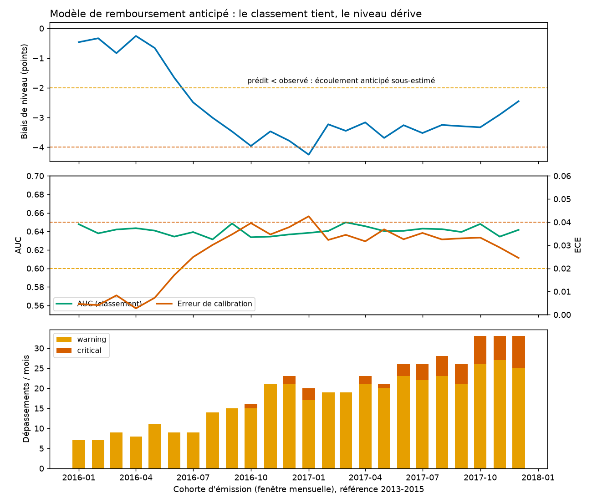
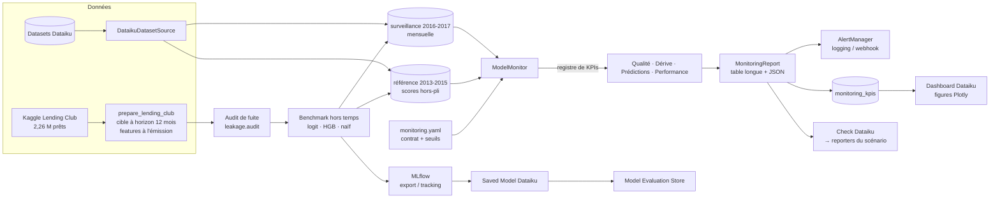
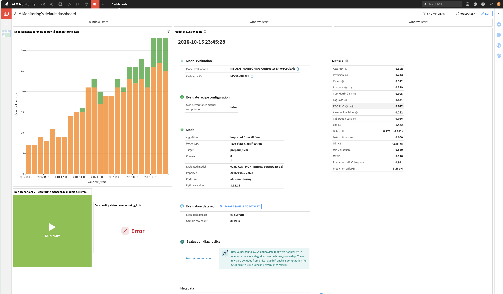

# ALM Model Monitoring

> Framework de monitoring MLOps pour les modèles comportementaux ALM (gestion actif-passif),
> conçu pour Dataiku : dérive des données, dérive des prédictions, dégradation de la
> performance et qualité des données en entrée, avec seuils justifiés, alertes et
> documentation de bout en bout. Cas d'application : un modèle de **remboursement anticipé**
> entraîné sur 791 538 prêts (2013-2015) et surveillé sur 877 986 prêts (2016-2017),
> soit 1,7 million de prêts réels (Lending Club).


---

## Pourquoi ce projet

Les modèles ALM (remboursement anticipé, écoulement des dépôts à vue, propension au dépôt
à terme) alimentent les projections de flux, les ratios de liquidité et la mesure du risque
de taux. Quand leurs entrées ou leur comportement dérivent, l'erreur se propage
silencieusement dans le pilotage du bilan. Ce dépôt est un **framework de monitoring
indépendant du modèle** : on déclare le contrat de données d'un modèle dans un YAML, et
tous les KPIs, le dashboard, les alertes et les recettes Dataiku s'y appliquent sans
changer une ligne de code.

Il a été construit comme une réponse point par point aux trois axes de la mission
*monitoring des modèles ALM-MODE sur Dataiku* :

| Axe de la mission | Où le trouver |
|---|---|
| **Cadrage et stratégie de monitoring** : conception des KPIs, justification méthodologique | [`docs/methodologie_kpi.md`](docs/methodologie_kpi.md), [`configs/`](configs/), notebooks 01-02 |
| **Implémentation et industrialisation sur Dataiku** : Model Evaluation Store, scénarios, plugin, alertes, dashboards, architecture holistique | [`dataiku/`](dataiku/), [`docs/guide_implementation_dataiku.md`](docs/guide_implementation_dataiku.md), [`src/alm_monitoring/`](src/alm_monitoring/) |
| **Documentation et capitalisation** : documentation de bout en bout, passation | [`docs/architecture.md`](docs/architecture.md), [`docs/passation.md`](docs/passation.md), notebooks 01-03, ce README |

## Ce que montre le cas d'application

Un modèle de probabilité de remboursement anticipé à 12 mois, entraîné sur les cohortes
2013-2015 (791 538 prêts) et surveillé **mois par mois** sur 2016-2017 (877 986 prêts).
Aucune dérive n'est simulée : tout est réel.



* **Le classement tient, le niveau dérive.** L'AUC reste autour de 0,64 sur 24 mois, mais
  le modèle sous-estime de plus en plus les remboursements anticipés : moins de 1 point au
  premier semestre 2016, près de 4 points fin 2016 (4,2 points en janvier 2017, seuil
  critique). Un monitoring limité à l'AUC n'aurait rien vu ; les KPIs de **calibration** et
  de **biais de niveau** passent en avertissement dès juillet 2016.
* **Le signal avancé précède la cible.** La dérive des prédictions monte en septembre-
  octobre 2016, douze mois avant que les remboursements de ces cohortes soient observables.
* **Les dérives de données sont identifiées et nommées.** `int_rate` (changements de grille
  tarifaire, PSI jusqu'à 1,3) et `application_type` (demandes conjointes introduites fin
  2016). Premier *critical* en octobre 2016, critique continu à partir d'avril 2017.
* **Pas de fatigue d'alerte.** 4 à 18 dépassements sur une centaine de résultats mensuels,
  ciblés et interprétables.

Les figures interactives sont dans [`reports/lending_club/figures/`](reports/lending_club/figures/),
la synthèse dans [`reports/lending_club/summary.md`](reports/lending_club/summary.md).

## Architecture



**Principes de conception**

* **Un contrat de données, tous les modèles.** `ModelSpec` (features par type, cible, score,
  date) est la seule chose qu'un modèle déclare.
* **Registre de KPIs ouvert.** Un nouvel indicateur = une sous-classe + `@register` ; le
  monitor, le rapport, les figures, la recette et le plugin le découvrent.
* **Des rapports, pas des plantages.** Un flux cassé produit un rapport rouge, pas une
  exception dans un ordonnanceur.
* **Indicateurs avancés et retardés explicites.** La cible arrive avec 12 mois de retard ;
  la dérive des prédictions et la qualité des données portent l'alerte en attendant.
* **Sécurité par défaut.** `yaml.safe_load`, chemins confinés, anti-SSRF, secrets en
  variables d'environnement, téléchargements plafonnés, protection zip-slip.

## Catalogue des KPIs

| KPI | Famille | Périmètre | Sens | Seuils par défaut (warning / critical) |
|---|---|---|---|---|
| `data_availability` | qualité | fenêtre temporelle | — | ERROR si la fenêtre est vide ou < `min_sample_size` |
| `schema_conformity` | qualité | dataset | ↑ pire | — / 1 violation |
| `label_coverage` | qualité | fenêtre | ↓ pire | 0,95 / 0,80 — assiette réelle des KPI de performance |
| `missing_rate` | qualité | chaque feature | ↑ pire | 0,05 / 0,20 |
| `out_of_range_rate` | qualité | numériques | ↑ pire | 0,01 / 0,05 |
| `unseen_categories_rate` | qualité | catégorielles | ↑ pire | 0,01 / 0,05 |
| `psi` | dérive des données | toutes | ↑ pire | 0,10 / 0,25 |
| `js_distance` | dérive des données | toutes | ↑ pire | 0,10 / 0,20 |
| `ks_test` | dérive des données | numériques | ↑ pire | 0,10 / 0,20 |
| `cramers_v` | dérive des données | catégorielles | ↑ pire | 0,10 / 0,30 |
| `prediction_drift` | dérive des prédictions | score | ↑ pire | 0,10 / 0,25 |
| `auc` | performance | modèle | ↓ pire | 0,75 / 0,70 |
| `brier_score` | performance | modèle | ↑ pire | 0,10 / 0,15 |
| `calibration_error` | performance | modèle | ↑ pire | 0,03 / 0,06 |
| `level_bias` | performance | modèle | ↑ pire | 0,02 / 0,04 |
| `performance_degradation` | performance | modèle vs référence | ↑ pire | 5 % / 10 % |
| `log_loss`, `rmse`, `mae`, `r2` | performance | modèle | — | configurables |

Les seuils par défaut suivent les pratiques de place et ne servent qu'au cas synthétique ;
**en usage réel ils sont toujours surchargés par modèle** dans le YAML, avec un commentaire
qui les justifie. Exemple : le modèle Lending Club a un AUC hors temps de 0,64, donc ses
seuils d'AUC sont 0,61 / 0,58 (et non 0,75 / 0,70, qui alerteraient en permanence) ; voir
[`configs/lending_club_prepayment.yaml`](configs/lending_club_prepayment.yaml). La
méthodologie complète, KPI par KPI, est dans
[`docs/methodologie_kpi.md`](docs/methodologie_kpi.md). `alm-monitor list-kpis` affiche le
catalogue vivant.

## Démarrage rapide

```bash
# 1. Environnement (uv recommandé ; pip fonctionne aussi)
uv venv --python 3.12 && source .venv/bin/activate
uv sync --all-extras --group dev

# 2. Tout rejouer sur l'échantillon livré (≈ 1 min, sans identifiants Kaggle)
make demo

# 3. Pipeline complet sur les données réelles (identifiants Kaggle requis, ~10 min)
python scripts/download_data.py --dataset lending-club
make pipeline
```

`make pipeline` enchaîne : **audit de qualité des données** (verdict d'exploitabilité, sinon
arrêt) → préparation et **feature engineering** métier → **audit de fuite** → **benchmark**
hors temps (3 algorithmes × 2 jeux de features, PR-AUC incluse) → **explicabilité** du
champion (importance par permutation, sens économique) → **champion-challenger** sur les
fenêtres de surveillance → **monitoring mensuel** → figures → export MLflow.

Le code de sortie de `alm-monitor run` reflète la gravité (`0` ok, `1` warning,
`2` critical, `3` error) : utilisable tel quel dans un ordonnanceur ou une étape *Execute
shell* d'un scénario Dataiku.

En bibliothèque :

```python
from alm_monitoring import ModelMonitor

monitor = ModelMonitor.from_yaml("configs/lending_club_prepayment.yaml")
report = monitor.run(reference_df, current_df)
print(report.overall_severity, report.summary())
monitor.alerts.process(report)  # n'envoie que si la gravité atteint la politique
history = report.to_dataframe()  # table longue, prête pour Dataiku / Plotly
```

## Notebooks

Quatre notebooks exécutés, sans logique métier (ils importent le package) :

0. [`00_qualite_des_donnees_et_ground_truth`](notebooks/00_qualite_des_donnees_et_ground_truth.ipynb) :
   les dix contrôles de l'audit (doublons, règles métier, manquants et leur mécanisme,
   aberrants, distributions, multicolinéarité, cohérence temporelle, cible), les décisions
   prises, le déséquilibre des classes et pourquoi on ne rééquilibre pas.
1. [`01_comprendre_les_donnees`](notebooks/01_comprendre_les_donnees.ipynb) : le problème
   ALM, la cible à horizon fixe et le biais de censure, ce qui bouge dans le temps.
2. [`02_benchmark_et_leakage`](notebooks/02_benchmark_et_leakage.ipynb) : les quatre
   contrôles de fuite, une fuite volontaire pour montrer qu'ils la voient, le benchmark et
   la règle de sélection (la calibration prime en ALM).
3. [`03_kpis_et_dashboard`](notebooks/03_kpis_et_dashboard.ipynb) : les 24 fenêtres
   mensuelles, l'histoire de la dérive, ce que ferait l'équipe.

## Intégration Dataiku

Trois modes de livraison complémentaires (détails dans le
[guide d'implémentation](docs/guide_implementation_dataiku.md)) :

1. **Natif** : le champion exporté en MLflow est importé comme *Saved Model* et branché sur
   un **Model Evaluation Store** par une recette d'évaluation
   ([`dataiku/recipes/00_setup_project.py`](dataiku/recipes/00_setup_project.py)) :
   performance et data drift natifs à chaque build.
2. **Recette Python + scénario** : la recette
   ([`01_compute_alm_kpis.py`](dataiku/recipes/01_compute_alm_kpis.py)) calcule les KPIs ALM
   dans `monitoring_kpis` ; le scénario
   ([`02_scenario_monitoring.py`](dataiku/recipes/02_scenario_monitoring.py),
   [définition step-based](dataiku/scenarios/alm_monitoring_scenario.json)) construit le
   MES et les KPIs, exécute un **check Python personnalisé**, publie les variables
   `${alm_overall_severity}` et déclenche les **reporters** (mail / Teams).
3. **Plugin** : [`dataiku/plugin/`](dataiku/plugin/) emballe le calcul en recette visuelle
   avec formulaire, pour qu'un utilisateur métier monitore un nouveau modèle sans code.

Le dashboard est spécifié page par page dans
[`dataiku/dashboard/dashboard_monitoring.md`](dataiku/dashboard/dashboard_monitoring.md).
Un backend **PySpark** ([`alm_monitoring.spark`](src/alm_monitoring/spark/drift.py)) calcule
les KPIs de dérive avec les mêmes formules pour les recettes Spark sur l'historique complet.

> **Validé sur Dataiku DSS 15.1 Free Edition** : recette → `monitoring_kpis` (3 144 lignes),
> règle Data Quality en ERROR (33 dépassements), Saved Model importé de MLflow, Model
> Evaluation Store (AUC 0,642, calibration 0,026, data drift 0,771), scénario et dashboard.
> Captures dans [`docs/captures/`](docs/captures/), export du projet dans
> [`dataiku/export/`](dataiku/export/), retour d'expérience au
> [§6 du guide](docs/guide_implementation_dataiku.md#6-retour-dexécution-sur-dss-151-free-edition).
>
> 

## Deux modèles, un framework

| Modèle | Données | Rôle | Config |
|---|---|---|---|
| Remboursement anticipé à 12 mois | Lending Club, 1,7 M prêts modélisés (2013-2017) | Cas principal | `configs/lending_club_prepayment.yaml` |
| Propension au dépôt à terme | Bank Marketing (UCI), 41 188 appels 2008-2010 | Second cas : régime de crise extrême, le même YAML suffit | `configs/bank_marketing.yaml` |

Le second cas illustre le « s'applique nativement aux futurs modèles » : seul le fichier de
configuration diffère.

## Organisation du dépôt

```
├── configs/                 une configuration YAML par modèle
├── data/sample/             échantillon stratifié de 62 277 prêts (démo, CI, notebooks)
├── dataiku/                 recettes, scénario, check, plugin, spécification du dashboard
├── docs/                    méthodologie des KPIs, guide Dataiku, architecture, passation
├── notebooks/               01 données · 02 benchmark & fuite · 03 KPIs & dashboard
├── reports/<modele>/        history.csv, latest.json, summary.md, figures/
├── scripts/                 download_data · audit_data · train_lending_club ·
│                            train_baseline · run_monitoring · export_mlflow_model
├── src/alm_monitoring/
│   ├── config.py            schéma pydantic, yaml.safe_load
│   ├── kpis/                base + registre · dérive · performance · qualité
│   ├── data_audit.py        audit de qualité des données et de la cible (10 contrôles)
│   ├── leakage.py           audit de fuite de données
│   ├── modeling/            benchmark, sélection, explicabilité, champion-challenger
│   ├── monitor.py           orchestrateur (fenêtre entière / découpe temporelle)
│   ├── report.py            MonitoringReport (DataFrame / JSON)
│   ├── alerts.py            AlertManager, dispatchers logging & webhook
│   ├── security.py          confinement des chemins, politique d'URL, secrets
│   ├── data/                lending_club · bank_marketing · sources · synthetic
│   ├── spark/               backend PySpark des KPIs de dérive
│   ├── dataiku/             adaptateurs DSS (import paresseux du SDK)
│   ├── viz.py               figures Plotly
│   └── cli.py               alm-monitor
└── tests/                   unit · integration · security (328 tests, 97 % de couverture avec PySpark, 93 % sans)
```

## Qualité

| Garde-fou | Outil | Règle |
|---|---|---|
| Style | `ruff` (PEP 8 + 25 familles de règles dont bandit `S`) | zéro finding |
| Types | `mypy --strict` | zéro erreur |
| Tests | `pytest` (marqueurs unit / integration / security / slow) | couverture ≥ 90 % |
| Sécurité | `bandit`, `pip-audit`, suite de tests de sécurité | zéro haut/moyen |
| Pré-commit | `pre-commit` | tout ce qui précède à chaque commit |

```bash
make check        # ruff + mypy + bandit + pip-audit + pytest
```

Convention de langue : **identifiants en anglais** (`psi`, `reference`, `compute`, convention
universelle du code), **tout le texte en français** (docstrings, logs, messages, documentation).

## Données

* [Lending Club](https://www.kaggle.com/datasets/wordsforthewise/lending-club) (Kaggle,
  CC0) : 2 260 668 prêts 2007-2018, audités (aucun doublon, 0,6 % de valeurs impossibles
  neutralisées, manquant informatif conservé comme signal). Cible : prêt soldé dans les
  12 mois suivant l'émission et avant terme, 14,8 % de positifs. 23 colonnes post-octroi
  bannies des features (fuite), `initial_list_status` exclu (attribut opérationnel).
  Cohortes observables jusqu'à décembre 2017.
* [Bank Marketing](https://www.kaggle.com/datasets/henriqueyamahata/bank-marketing) (UCI) :
  41 188 appels, mai 2008 - novembre 2010 ; `duration` supprimée (fuite).

## Limites et périmètre

Ce dépôt est un dispositif de **détection**, pas une validation indépendante du modèle :
il signale, date et qualifie une dérive ; la décision (recalibrer, ré-estimer, changer de
champion) reste un acte de gouvernance du risque de modèle. Ce qu'il faut savoir avant
de le juger ou de le déployer :

| Question qu'un relecteur se pose | Réponse, et où la vérifier |
|---|---|
| Les seuils sont-ils génériques ? | Non : un YAML par modèle, chaque seuil ancré sur la performance hors temps du champion et commenté ([`configs/`](configs/), [méthodologie §3-5](docs/methodologie_kpi.md)). |
| Quelles formules exactement ? | ECE sur 10 classes de probabilité de largeur égale, pondéré par l'effectif ; `level_bias` = \|moyenne prédite − taux observé\| avec signe conservé ; PSI à 10 classes sur les quantiles de la référence ; détails et cas limites dans [`src/alm_monitoring/kpis/`](src/alm_monitoring/kpis/) et la [méthodologie](docs/methodologie_kpi.md). |
| La performance est-elle calculée sur des cibles censurées ? | Non : cible à horizon fixe (12 mois) définie à partir d'une date d'arrêté, cohortes immatures exclues, `error` (pas `ok`) si la cible manque ou si l'effectif est < 1 000 ([§6.1](docs/methodologie_kpi.md), [notebook 00](notebooks/00_qualite_des_donnees_et_ground_truth.ipynb)). Et l'**assiette** est visible : KPI `label_coverage` seuillé (0,95 / 0,80) et `n_total / n_labelled / excluded_rate` dans les détails de chaque KPI de performance, pour qu'un AUC calculé sur 60 % des lignes ne passe pas pour un AUC. |
| Une panne de données peut-elle passer pour « pas de dérive » ? | Non : un dataset vide lève une erreur ; une fenêtre mensuelle vide ou sous `min_sample_size` produit une ligne `data_availability` en gravité `error` (visible dans l'historique, le dashboard et la règle de qualité) au lieu d'être sautée ; hiérarchie d'exceptions (`DataSourceError`, `SchemaValidationError`, `InsufficientDataError`) et gravité `error` distincte de `critical`. |
| pandas et PySpark donnent-ils la même chose ? | Testé : [`tests/integration/test_spark_drift.py`](tests/integration/test_spark_drift.py) compare les deux backends sur les mêmes données (NaN/NULL alignés, catégories rares, **référence constante**). Les cas limites univariés (référence = courant, colonne constante, tout-NaN, catégorie unique) sont dans [`tests/unit/test_drift_edge_cases.py`](tests/unit/test_drift_edge_cases.py) ; ils ont révélé et corrigé un angle mort : une référence constante donnait PSI = 0 quel que soit le courant, dans les deux backends. |
| Le découpage temporel est-il sûr ? | Oui : fenêtres construites sur des **positions** de lignes (`iloc`), jamais sur les étiquettes d'index — un index dupliqué (`concat` sans `ignore_index`) ne duplique aucune observation ; les horodatages non analysables sont écartés et **comptés** (`unparsed_timestamp_rows`). Testé : index unique, index dupliqué, dates invalides. |
| Chaque résultat est-il traçable ? | Oui : `run_id`, `run_at`, `model_name`, `model_version`, **`config_fingerprint`** (empreinte SHA-256 de la configuration effective : seuils, features, paramètres) et **`package_version`** sur chaque ligne de `monitoring_kpis`, plus les seuils appliqués et les effectifs (`detail_n_*`) ; la recette écrase le dataset, relancer le scénario ne duplique rien (en mode *append*, la clé serait `model_version × window_start`). |
| Une dérive statistique est-elle une dérive qui compte ? | Pas forcément : un PSI élevé déclenche une analyse, pas une action. Le seul KPI relié directement à l'impact ALM est `level_bias` (3 points sur un taux de 17 % ≈ un cinquième de l'écoulement anticipé) ; relier les autres à l'impact sur les flux projetés est un travail métier, pas un calcul. |

Ce qui n'est **pas** traité, délibérément ou faute de temps :

* **Saisonnalité et régimes** : chaque mois est comparé à une référence fixe (2013-2015).
  Les remboursements anticipés sont saisonniers et dépendent du niveau des taux ; une
  comparaison au même mois de l'année précédente, ou une référence par régime de taux,
  réduirait les fausses alertes. C'est la première évolution à faire.
* **Incertitude** : pas d'intervalle de confiance ; acceptable à 20 000 lignes par mois,
  pas pour des segments fins.
* **Segments** : KPIs sur la population entière ; une dérive concentrée (prêts 60 mois,
  grade E) est diluée.
* **Interactions** : dérives univariées + modèle de dérive multivarié natif du MES, mais pas
  d'analyse des relations entre variables.
* **Exploitation bancaire** : responsables d'alerte, délais, escalade, séparation des
  droits, reprise sur incident ne sont pas spécifiés ; ils dépendent de l'organisation.
* **Versions** : le modèle a été entraîné avec scikit-learn 1.9.1 et évalué dans DSS avec
  1.6.1 (avertissement, résultats identiques) ; en production, une seule version figée.

## Feuille de route

* Référence saisonnière (même mois N−1) et référence par régime de taux.
* KPIs par segment (produit, durée, grade) avec agrégation hiérarchique des gravités.
* Référence glissante et re-baselining automatique après ré-estimation validée.
* Intervalles de confiance sur les KPIs pour les segments fins.
* Reporter mail/Teams et déclencheurs du scénario sur une édition complète de DSS (non disponibles en Free Edition).

## Licence

MIT, voir [LICENSE](LICENSE).
